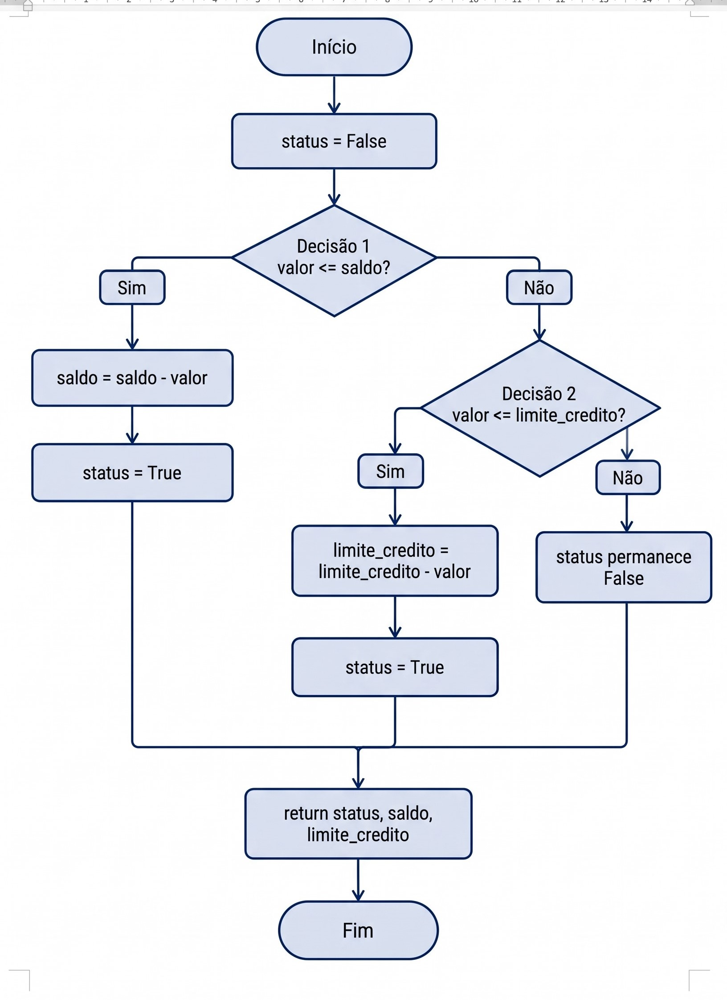

# Teste de Fluxo de Controle — Função de Saque

Atividade prática desenvolvida na disciplina de Qualidade e Automação de Testes do curso de Análise e Desenvolvimento de Sistemas.

## Objetivo

Elaborar o Grafo de Fluxo de Controle (GFC) de uma função de saque bancário e implementar casos de teste em Python capazes de validar todos os caminhos independentes do fluxo lógico (teste de caixa-branca).

## Regra de Negócio e Fluxo de Controle

A função `saque(valor, saldo, limite_credito)` avalia a solicitação de saque em duas etapas de decisão:

1. **Decisão 1 (`valor <= saldo`):** Se houver saldo suficiente em conta, o valor é descontado do `saldo` e a operação é aprovada (`status = True`).
2. **Decisão 2 (`valor <= limite_credito`):** Caso o saldo seja insuficiente, verifica-se se o valor cabe no `limite_credito`. Se couber, o valor é descontado do limite e a operação é aprovada (`status = True`).
3. **Saque negado:** Se o valor superar tanto o saldo quanto o limite de crédito, os valores permanecem inalterados e a operação retorna `status = False`.

Ao final, a função retorna a tupla `(status, saldo, limite_credito)`.

### Grafo de Fluxo de Controle



## Casos de Teste Implementados

Para cobrir os 3 caminhos independentes do grafo, foram estruturados os seguintes cenários no arquivo `teste_saque.py`:

| Caso de Teste | Valor do Saque | Saldo Inicial | Limite Inicial | Caminho no Grafo | Resultado Esperado `(status, saldo, limite)` |
| :--- | :---: | :---: | :---: | :--- | :---: |
| **Caso 1** — Saque dentro do saldo | 300 | 1000 | 500 | Decisão 1: Sim | `(True, 700, 500)` |
| **Caso 2** — Saque utilizando o limite de crédito | 1200 | 1000 | 1500 | Decisão 1: Não → Decisão 2: Sim | `(True, 1000, 300)` |
| **Caso 3** — Saque acima do saldo e do limite | 1600 | 1000 | 500 | Decisão 1: Não → Decisão 2: Não | `(False, 1000, 500)` |

## Como Executar

No terminal, dentro da pasta da atividade, execute:

```bash
python teste_saque.py

## Saída dos testes

Caso 1 - Saque dentro do saldo
Valor do saque: 300
Saldo inicial: 1000
Limite de credito inicial: 500
Resultado esperado: (True, 700, 500)
Resultado obtido: (True, 700, 500)
Teste aprovado: True
---------------------------------------------
Caso 2 - Saque utilizando o limite de credito
Valor do saque: 1200
Saldo inicial: 1000
Limite de credito inicial: 1500
Resultado esperado: (True, 1000, 300)
Resultado obtido: (True, 1000, 300)
Teste aprovado: True
---------------------------------------------
Caso 3 - Saque acima do saldo e do limite
Valor do saque: 1600
Saldo inicial: 1000
Limite de credito inicial: 500
Resultado esperado: (False, 1000, 500)
Resultado obtido: (False, 1000, 500)
Teste aprovado: True
---------------------------------------------